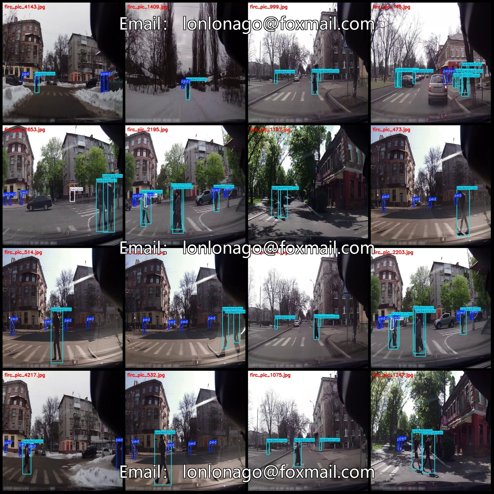
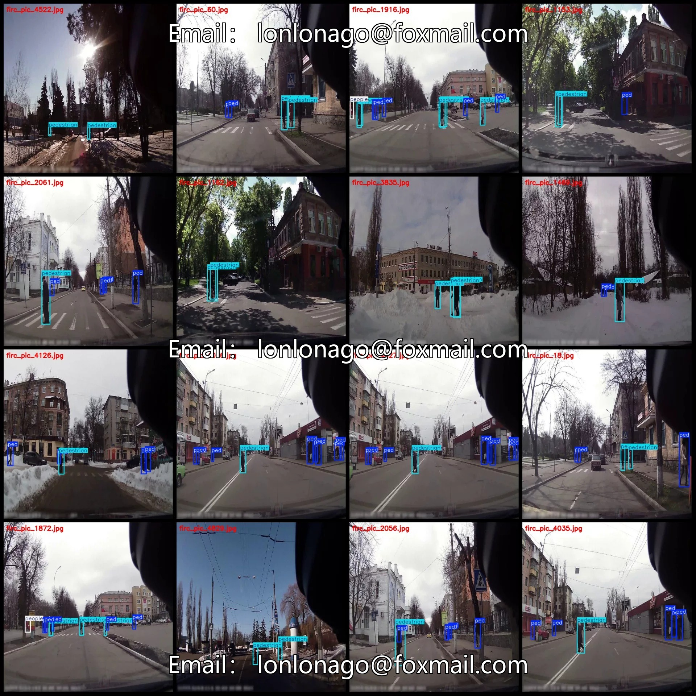
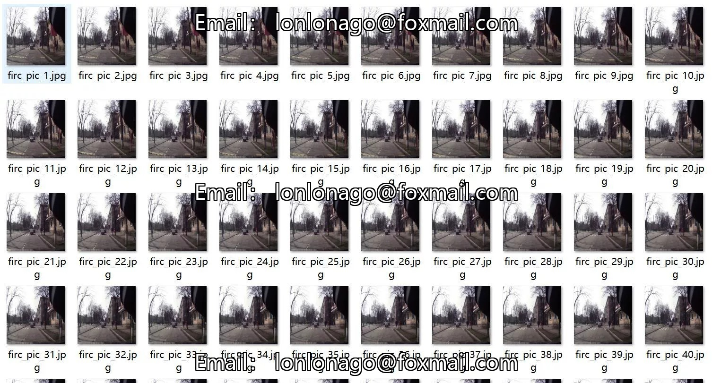
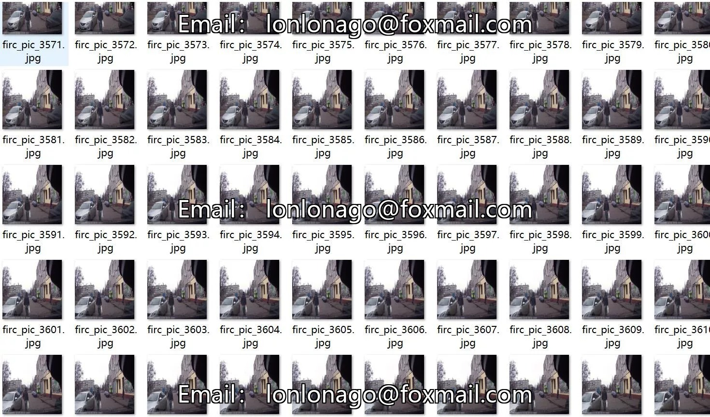
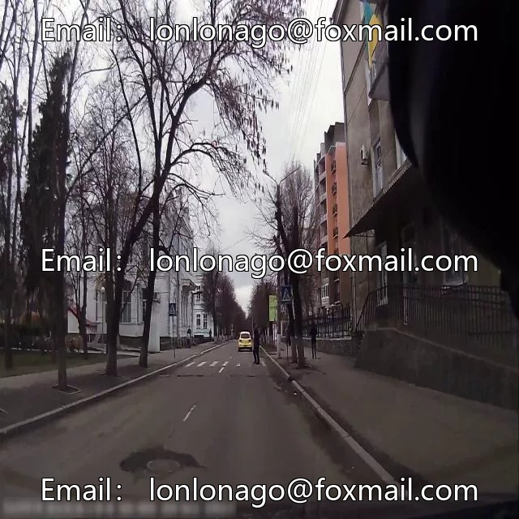
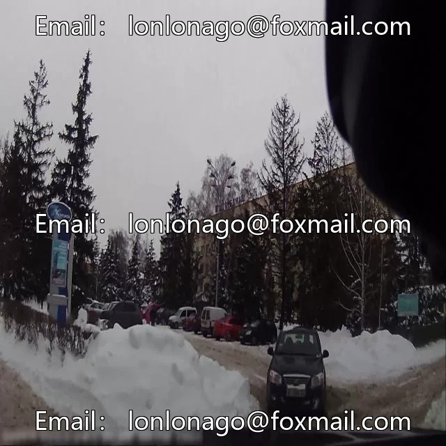

# Autonomous Driving Scenarios Vehicle Monitoring Perspective Pedestrian Attention Detection Dataset VOC+YOLO

## Body

Autonomous Driving Scenarios: Pedestrian Attention Monitoring Data Set - VOC+YOLO Format - 4904 Images in 3 Categories
Warm Reminder: Since the dataset is replicabile, please confirm compliance before purchasing.
Note: The images are extracted from video frames, hence there may appear to be many "duplicate" images.
Dataset Format: Pascal VOC format + YOLO format (txt file without split path, only containing jpg images and corresponding VOC format xml files and yolo format txt files)
Number of Images (JPG File Count): 4904
Number of Annotations (XML File Count): 4904
Number of Annotations (TXT File Count): 4904
Number of Annotation Categories: 3

Label categories (note that the order of labels in yolo format does not correspond to this, but is based on the classes.txt file in the labels folder): ["ped", "pedestrian", "people"]
Number of boxes and images per category:
- Ped (unimportant pedestrians) : Number of boxes = 14377, Number of images = 3955
- Pedestrian (close-up important pedestrians) : Number of boxes = 13019, Number of images = 4650
- People (faraway crowds) : Number of boxes = 1165, Number of images = 1101
Total number of boxes: 28561
Image resolution: 640x640
Using labeling tool: labelImg

Annotation rules: Draw a rectangle around the category.
Important Notice: The dataset does not have separate training, validation, and test sets; you need to partition them yourself.
Special : This dataset does not guarantee the accuracy of the trained models or weight files.

## Images

## Payment

Here is a pay link on Stripe ( https://buy.stripe.com/3cs8yP7sY87d0vu9AB ). Please contact me lonlonago@foxmail.com after funding $89, and I will send you a complete data files , thank you!

